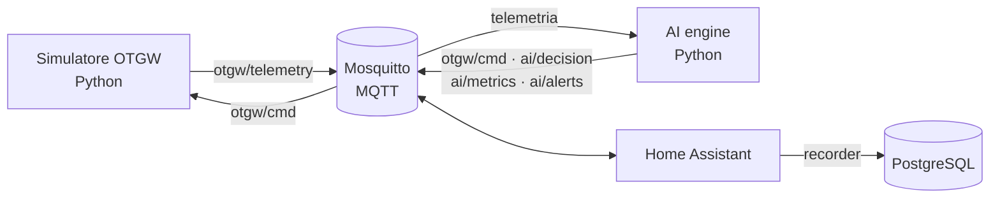

# Heating Simulator · Techloop Sim

Laboratorio IoT in Docker che simula una caldaia **OpenTherm** e la integra con **Home Assistant** via MQTT.
Un motore di controllo in Python regola il setpoint della caldaia in base alla temperatura della stanza e a quella esterna. Riconosce anche finestre aperte e riscaldamento inefficiente, e si autoregola nel tempo.


---

## Funzionalità

- **Simulatore OTGW** (`simulator/`): riproduce un OpenTherm Gateway con un modello termico semplificato (massa termica, isolamento, resa dei radiatori, isteresi del bruciatore e modulazione). Pubblica la telemetria ogni 2 secondi e accetta comandi via MQTT.
- **AI engine** (`ai-engine/`): controller proporzionale con compensazione climatica, deadband e limite di variazione per passo.
  - Rileva una **possibile finestra aperta** da un calo rapido della temperatura e mette il setpoint in pausa.
  - Diagnostica il **riscaldamento inefficiente** (errore alto, modulazione alta e trend piatto) e prova un boost temporaneo.
  - **Auto-tuning** di `Kp` e `BASE` con due profili (`comfort` ed `eco`). Lo stato viene salvato su disco.
- **Home Assistant** (`homeassistant/`): sensori MQTT, comandi manuali, interruttore "AI Mode" e automazioni che segnalano dispositivo offline e valori fuori range.
- **PostgreSQL** come database del recorder di Home Assistant, con sensori sulle dimensioni del DB e script di backup e ripristino.
- **pgAdmin** opzionale per gestire il database.

## Architettura



| Topic MQTT | Direzione | Contenuto |
|---|---|---|
| `otgw/telemetry` | simulatore → tutti | temperature stanza/esterna/caldaia/ritorno, modulazione, fiamma |
| `otgw/cmd` | AI / HA → simulatore | `{"ch_setpoint_c": 55, "ch_enabled": true}` |
| `ai/mode`, `ai/room_target_c` | HA → AI engine | attivazione dell'AI e temperatura desiderata |
| `ai/decision`, `ai/metrics`, `ai/alerts`, `ai/tuning` | AI engine → HA | decisioni, metriche, allarmi, eventi di tuning |

## Avvio rapido

Requisiti: Docker con Docker Compose v2.

```bash
git clone https://github.com/Juans77/heating-simulator.git
cd heating-simulator

# 1. Variabili d'ambiente: imposta password vere
cp .env.example .env

# 2. Segreti di Home Assistant: stessa password di POSTGRES_PASSWORD
cp homeassistant/secrets.yaml.example homeassistant/secrets.yaml

# 3. Cartelle per i dati e avvio
./setup.sh
docker compose up -d --build

# pgAdmin (facoltativo)
docker compose --profile admin up -d
```

| Servizio | Indirizzo |
|---|---|
| Home Assistant | http://localhost:8123 |
| pgAdmin (profilo `admin`) | http://localhost:5050 |
| Broker MQTT | `localhost:1883` |

Per seguire la simulazione: `docker compose logs -f simulator ai-engine`.

## Configurazione

- **`.env`**: credenziali di PostgreSQL e pgAdmin (vedi [`.env.example`](.env.example)). Docker Compose si ferma con un messaggio chiaro se mancano.
- **`homeassistant/secrets.yaml`**: stringa di connessione `ha_db_url` usata dal recorder e dai sensori SQL.
- **Parametri del controllo**: variabili d'ambiente del servizio `ai-engine` in [`docker-compose.yml`](docker-compose.yml): `KP`, `BASE`, `PROFILE`, `DEADBAND_C`, `MAX_STEP_C` e le soglie di finestra aperta (`DROP_THRESHOLD_*`, `WINDOW_HOLD_MIN`) e di inefficienza (`INEFF_*`).
- **Fisica del simulatore**: `HOUSE_THERMAL_MASS`, `HOUSE_INSULATION`, `RADIATOR_EFFICIENCY`, `PUBLISH_INTERVAL`.

## Struttura

```
ai-engine/          controller, rilevamento anomalie e auto-tuning (Python)
simulator/          simulatore OpenTherm Gateway (Python)
homeassistant/      configurazione, sensori MQTT e automazioni di Home Assistant
mosquitto/config/   configurazione del broker MQTT
postgres/config/    parametri di PostgreSQL
scripts/            backup e ripristino del database
docs/               guida alla migrazione da SQLite a PostgreSQL
```

## Backup

```bash
./scripts/backup_postgres.sh    # crea backups/postgres/ha_backup_<data>.sql.gz
./scripts/restore_postgres.sh   # ripristina un backup
```

I dettagli sulla migrazione, le query utili e la risoluzione dei problemi sono in [docs/MIGRAZIONE-POSTGRESQL.md](docs/MIGRAZIONE-POSTGRESQL.md).

## Note di sicurezza

Il progetto è pensato come **laboratorio locale**:

- il broker MQTT accetta connessioni anonime (`allow_anonymous true`);
- PostgreSQL e pgAdmin sono raggiungibili solo da `127.0.0.1`.

Prima di esporlo in rete, attiva l'autenticazione su Mosquitto e usa password robuste.

## Contesto

Progetto sviluppato durante il percorso ITS, nell'ambito del progetto di gruppo Techloop dedicato a domotica e Home Assistant.
